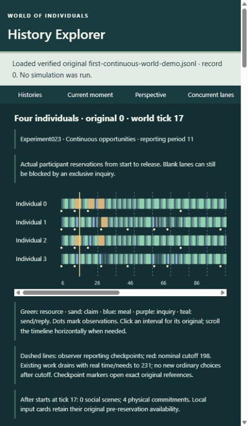

# First Continuous World — delivery report

The program reached a qualified continuous-world prototype and readiness decision.
The protected endpoint is 001–022. Experiment 023 remains experimental, pending
independent review. No 024, production mechanism, default adoption or canon change
was begun. Authorization: attachment b0b8dfac; starting revision 9fb6da8.

## Part A — independent 022 scientific review

**ACCEPT WITH QUALIFICATION.** Independent reconstruction of 100 original worlds
(50 matched pairs) found 41 capacity-two worlds reaching two simultaneous scenes;
24 interim and 15 terminal food-ledger differences, 20 terminal hunger differences,
31 normalized trust differences and nine complete capacity nulls. The 84 distinct
label-neutral histories are not 100 independent samples. Actual overlapping scenes,
unequal completion, claims and meals were checked. Public inquiry masks, consented
AtomicBlocked admissions and executed queries remain distinct.

Implemented needs/sensing use comparison-epoch phase, despite prospective prose
specifying absolute phase. Matched comparisons and accounting hold; absolute-phase
invariance does not follow. Original prose and outcomes were preserved. Independent
readers, scratch controls and exact replay support qualified protection, without
scheduler adoption. See [review](../experiment-022-review.md).

## Part B — foundation protection

The [contract](../experiment-contract-001-022.md),
[audit](../integrity-audit-001-022.md),
[inventory](../foundation-001-022-sha256.json) and
[handoff](../research-handoff-001-022.md) protect **361 original artifacts**:
341 inherited unchanged plus 20 original 022 files. All 378 initially recorded
working experiment/reinforcement files remain byte-identical. Hash conventions
remain mode-specific. Unavailable cognition cannot be restored from observer
history; separately established persistent aggregates may survive episode eviction.

Root formatting, Clippy, 217 tests and the normal 001–022 validator passed; the
final normal gate took 1,439.006 seconds. Required standalone gates passed during
protection at unchanged source/fixture revisions. The shared 022 prefix matches
its standalone gate. [Executed checks](continuous-world-final-validation.json).

## Part C — main History Explorer

The native 022 adapter displays four lanes on a common clock, actual owned inputs,
independent replies, physical release and typed causal references. Ten authentic
acceptance families were inspected in the main browser. Actor and Observer scopes
stay separate; unavailable inputs remain unknown. No interpolation or archive
recovery supplies cognition. [022 acceptance](main022-viewer-acceptance.md).

Explicit `--continuous` sources add 42 registered 023 histories and optional custom
prototype files to the default 814-history catalog. The 023 envelope is preserved
without coercion to 021. Report, nominal and final markers use actual references.
Query delivery joins execution identity and explicit inquiry/provenance/cognitive
receipt IDs. A null native response does not imply no information. All 56 main
Python tests, four old-preview tests, four legacy JavaScript suites and actual
browser checks passed. [023 acceptance](main023-viewer-acceptance.md).

## Part D — continuous scheduling study

Question: can four persistent individuals continue legitimate independent activity
across reporting boundaries, under local information, consent, one clock and
conservation? Registration cf946fa preceded implementation and treatment outcomes.

Windowed projects the next public reporting end; Continuous projects `now + 33`,
independently of reporting/evaluation end. Both reuse inherited policies, physical
and cognitive law, capacity two, food and matched starting state. New ordinary
choices stop at nominal T; existing work/protocol settles through common T+33.
Epoch and Absolute phase cases are separately registered. Checkpoints contain
observer-only IDs/references. No scoring, supply or retention rules changed.

The [42 originals](../../experiments/023/archive-manifest.json) comprise 20 matched
pairs and two reporting placebos. Nineteen pairs change choices/execution; 12 have
terminal food differences, five hunger differences and 19 trust differences.
One pair is a complete selected/executed/state null apart from intended public
budget projection; three temporary food divergences reconverge. Twenty worlds
have strict report crossings; 26 have unfinished work at nominal end. Fourteen
pairs contain someone with higher full hunger area, seven someone with lower
area (overlapping counts; before nominal end, 14/6). Fifteen have more zero-transfer
scenes. These are fixture counts, not population statistics or total welfare.

In original 1, owned receipt at 14 supports Acquire 30 over Invite 13. Claim 20
runs 14–18 across report 17; its grant changes owned input at 18 and precedes an
executed transfer at 22. Clean negative 10/11 holds actor 2's input at 7 constant
except budget: Invite 64 beats Consume 5, delaying the meal by one tick, followed
by a Leave/no-transfer scene. Hunger area rises five. In 4/5 all four areas rise.
Original 19 leaves two held food units unused; 23 consumes all food and continues
empty contact. These are distinct failures. Eight Direct queries legitimately
change support 0→50 and Open→Partial via provenance receipts, despite null native
responses; novelty value 40 is separate. No Evidence query executes here.

**ACCEPT WITH QUALIFICATION, pending independent review.** The source-preserving
host reproduced all 100 protected 022 originals before treatment. All 42 original
023 histories replay byte-for-byte and pass independent clock/input/cognition/
consent/physical reconstruction. Nineteen scratch categories, two supplemental
terminal/query controls, 20 prefix comparisons and 16/16 coverage families pass.
Original 80-file source freeze and five helper locks are unchanged. The prospective
architecture mistakenly estimated 32 episodes; actual inherited capacity 16 was
preserved, disclosed and independently regression-tested. Original runtime,
specification and archives were not rewritten.
[Results](../../experiments/023/results.md), [verification](../../experiments/023/verification.md).

## Part E — runnable first continuous world

From repository root, use a **new output filename**:

```powershell
cargo run --release --locked -j 1 --manifest-path prototypes/continuous-world/Cargo.toml --target-dir target/continuous-world --bin continuous-world -- run target/my-continuous-world.jsonl --case paired --ticks 192 --period 11 --seed 42
python -B tools/history-explorer/explorer.py --continuous experiments/023 --continuous target/my-continuous-world.jsonl
```

Add `--port 8769` if 8765 is occupied. Source edits are unnecessary.
See [runner options and replay](../../prototypes/continuous-world/README.md).
The actual delivered `target/first-continuous-world-demo.jsonl` uses the same four
actors from tick 6, 192 ordinary ticks to 198, then charged drain to 231. It records
89 social scenes and ten strict report crossings; final food is [1,1,0,0], cache
zero, consumed food ten, hunger 100 for everyone, and no live work. This custom
demo is outside the original 42-world matrix. Its independent validation and exact
replay passed. [Proof](continuous-prototype-demo-verification.json),
[walkthrough](first-continuous-world-walkthrough.md).

The main browser inspected crossing 17, unfinished Resource 479 at nominal 198,
settled state 231, and legacy 022/021 views; the console was clear. The prototype
is left open. This is a genuine browser capture. The CLI executes the simulation;
the viewer presents history. Neither is a snapshot-resume or unbounded real-time
world service.



## Part F — readiness and future material work

Continuous individual activity is demonstrated within controlled bounds;
sustainable minimum-community life is not. Finite food runs out, held food can
remain unused, and inherited contact values can displace meals. There is no
mortality or production model. Four co-present actors with controlled bootstrap
are not evidence of natural society or psychological realism.

The immediate next gate is independent 023 review, followed by any separately
accepted integrity pass. The next material candidate remains finite raw stock →
timed owned process → food plus waste, likely 024 only under new authorization.
More supply cannot conceal valuation failures. No farms, markets, institutions
or general planner are proposed for this pass. [Readiness decision](continuous-world-readiness.md).

Storage is 75.344 MB decoded / 1.811 MB gzip for 42 originals. Recording-process
peak working set 13.537 MB includes audit, not deep cognitive heap. Live commitments
and pending tokens peak at four; the 304-byte active-payload estimate excludes
containers, allocator overhead and slack. At 768 ordinary ticks Continuous records
18.566 MB, with median simulation 52.747 ms and serialization 34.084 ms over three
host samples. Replay takes 0.682 s; independent reconstruction 10.246 s. Viewer
catalog construction takes 2.711 s; a long sample loads in 0.776 s and exports
13.429 MB. Audit grows despite bounded owned state. These are local measurements,
not scalability rankings. Cold duplicate compilation/source-host coupling remain.

## Fifteen final scientific questions

| Question | Evidence-grounded answer |
|---|---|
| 1. Does 022 withstand review? | Yes, qualified by implemented epoch law and controlled fixtures. |
| 2. What is protected? | Qualified 001–022 mechanisms/findings and 361 originals; no default adoption. |
| 3. Can the main viewer show four-person history? | Yes: native 022 and optional 023, with actual browser acceptance. |
| 4. Which waits were artificial closure? | 75/80 late budget probes change. Original 33@196 has no food/cache; new control actor 0@14–16 knows cache stock but lacks fitting time. Not every Wait is rest or a lost useful gift. |
| 5. Can work cross reports? | Yes, 20 worlds contain strict crossings; two report placebos preserve exact histories. |
| 6. Are locality/physics preserved? | All 42 undergo independent input/cognitive/primitive/tick reconstruction, source checks and corruption controls. |
| 7. Can simultaneous work avoid duplicate time? | Disjoint scenes share one tick/need pulse, with no double booking. |
| 8. Do choices differ? | Yes, 19/20 matched configuration pairs, with fixed scores and food. |
| 9. Do consequences persist? | Twelve terminal food, 19 trust and five hunger differences, plus subsequent owned inputs/actions. |
| 10. Can outcomes worsen? | Clean meal-delay cost +5; all four higher hunger areas in 4/5; mixed effects elsewhere. |
| 11. Does exhaustion matter? | Yes: 23 consumes all food then continues empty contact; 19 instead neglects held food. |
| 12. Continuous life versus community? | Persistent causal activity is supported; biological survival and sustainable community are not established. |
| 13. Architectural limits? | Atomic inquiry, fixed four/co-presence/sensing, constructed bootstrap, finite cutoff/drain, audit growth, source-host coupling and no resume/real-time service. |
| 14. Is finite preparation next? | It remains the conditional material candidate; independent review and valuation diagnosis come first. New authorization is required. |
| 15. Before minimum viable community? | Reviewed continuity, meaningful chosen/accounted material use, persistent consequences, adverse controls, bounded information, practical cost and explicit viability definition. |

## Publication record

| Milestone | Published commit |
|---|---|
| Independent 022 review | 14077d5fe0170c93801c1cf82fe420c27fc485cd |
| Protected 001–022 | 355c69097efd92414f7ffefed2ebb7cc7aedacbf |
| Main 022 integration | 29e19d28aaffa4fcd705ebef052a74ecccf8e8a3 |
| Prospective 023 registration | cf946fa1f4b2118f0e7c322c4eefb4d6906b1a54 |
| Scheduler/original evidence | ec941d8fbafe985a4c2026e409998587d71e9d4e |
| Main prototype/viewer | 83487c7f6dc837ca9665b03fe0e266a125918436 |
| Readiness/final report | This document's readiness commit; exact HEAD/origin identity is verified after publication and reported in the final response. |

All pushes use origin main without force/history rewriting.
[Completion evidence map](continuous-world-completion-audit.md).
