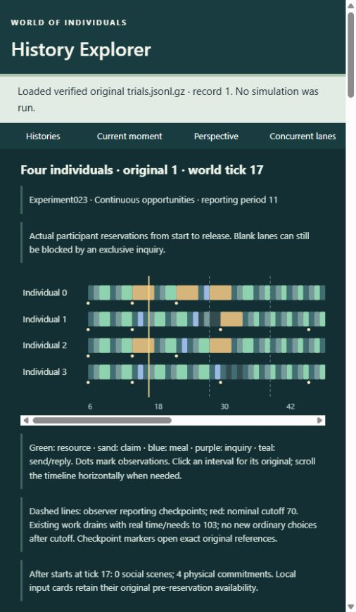

# First Continuous World - authentic walkthrough

This is one persistent four-person simulation, not a montage of reset periods.
Experiment023is opt-in research, ACCEPT WITH QUALIFICATION pending independent
review. [Runner guide](../../prototypes/continuous-world/README.md),
[results](../../experiments/023/results.md), [causal slices](../../experiments/023/causal-slices.json).
Four individuals are actual simulation actors0-3. The initial relationships derive
from executed controlled bootstrap scenes, followed by declared starting-state
interventions. This does not demonstrate natural group formation.

## Run and inspect

From the repository root, choose a NEW output filename:

```powershell
cargo run --release --locked -j 1 --manifest-path prototypes/continuous-world/Cargo.toml --target-dir target/continuous-world --bin continuous-world -- run target/my-continuous-world.jsonl --case paired --ticks 192 --period 11 --seed 42
python -B tools/history-explorer/explorer.py --continuous experiments/023 --continuous target/my-continuous-world.jsonl
```

Open the printed loopback URL. Add `--port 8769` if8765is already occupied. In the
library choose **023 - Open actual prototype run** (middle dots in the actual UI).
Observer Perspective displays all four lanes on one shared axis; Actor Perspective
shows only the selected individual's exact captured input or owned snapshot.
Dashed report markers open original `checkpoints[n]`. Narrow screens scroll the
axis horizontally. Play/Jump display recorded history; they do not execute simulation.

The actual program demonstration was executed as
`target/first-continuous-world-demo.jsonl` with the same192tickparameters. It starts6,
stops NEW ordinary choices198and finishes the charged drain231. It has89completed
social scenes,10strict reporting crossings, final food[1,1,0,0], cache0and hunger100
for all. Independent reconstruction and exact replay passed. This is a custom
prototype run, explicitly labelled outside the registered42worldmatrix. On a new
clone recreate it with the CLI; ignored `target` files are not historical evidence.

For immutable tracked evidence, select the **023 reporting crossing / mixed costs**
preset. Originals0/1compare Windowed/Continuous with64ordinary ticks, start6,
nominal70and shared final103. Original17provides the registered192tickongoing
history. Exact references below identify original1unless another ordinal is stated;
`history.*` addresses its original023physical-history member, never a021conversion.

## Two simultaneous independent scenes

At6all four choose their own invitations. At7recipients independently answer.
At8two disjoint resource commitments reserve0/1and2/3. Two Offers occur9and two
Accepts10. One global pulse10updates all four; time is not charged twice because
two scenes run. The respective release records make each pair available. No
controller chooses the pairs after seeing desirable outcomes.

## A material commitment continues across reporting17

Actor0at14has food0/hunger30 and its OWN receipt1: stock4observed at14, own-takes0.
At `history.boundaries[8].choices[0]` it selects Acquire30over Invite13; other
choices remain Wait0and ineligible Consume. This is its locally retained estimate,
not an observer stock lookup. Claim20runs14-18. Actor2independently runs Claim22.

Click report17. `checkpoints[0]` retains active IDs[20,22,28,29] and pending source10
protocols from1and3. Claims0and2continue while1and3reply. Nothing is released,
restarted, refreshed or forgotten merely because the report occurred. Actor0has
no decision at this observer checkpoint; its Actor panel stays empty.

At18`history.grants[0]` records stock4to3and actor0food0to1; actor2's separate grant
reduces stock3to2. Actor0's next own input (`history.boundaries[12].choices[0]`)
contains food1/hunger35and own-takes1on receipt1. It still estimates upperbound3;
observer stock2is shown separately. It cannot recover rival actions from audit.

Actor0then chooses contact2(score48vs Consume35). The resulting20-22resource
scene executes Offer/Accept and actually transfers a unit. That food and the
encounter's relationship/episode effects persist into later decisions. This is
a real continuation/material-use chain, not a claim of better life. Control0's
14claim cannot fit its17budget and instead starts17/finishes21; after earlier
choice10their hunger/history already differ, so do not treat the14inputs as matched.

## Continued periods preserve consequences and mistakes

The same people, inventories, finite cache, directed trust, concerns, learning and
bounded memory persist through28,39,50,61and later reports. No period constructor
is called. Later invitations can be unavailable or declined; fulfilled scenes can
transfer nothing. Trust and other established aggregates can outlive evicted
episodes under legacy contracts. Episodic cap is16, not the32mistakenly estimated
in the prospective architecture; evidence/provenance/learning caps remain32.

For a clean mistake open original11, actor2at7. Its own food1/hunger5 supports
Consume5, but it chooses Invite0with score64. The Windowed14budget would exclude
that8tickreservation; counterpart10consumes7-8. Continuous sends7-8, then consumes
8-9while its original invitation remains pending. The admitted9scene executes
Leave10with zero transfer because it has since eaten. The extra tick at hunger5
adds5to actor2's hunger area. No hidden future food knowledge or useful outcome was
scripted. The generic invitation value did not anticipate the later meal.

The larger4/5comparison has higher hunger area for ALL four under Continuous,
with6vs10meals and retained unused food. More transfers are not new food and are
not universal benefit. In long18/19the cache empties but two owned units remain
unused under Continuous. In22/23all of the single initial unit is consumed, yet
empty contact continues. Distinguish cache exhaustion, complete food exhaustion
and failure to consume still-owned food.

## Inquiry and a genuine null

Open original13. Query2reserves0/2from6to19and crosses report15. The other lanes
are globally blocked by the inherited atomic inquiry rule; no interior actor
choices are invented. The actual delivery route is explicit: inquiry0->provenance
query0->receipt1->cognitive information0. The native inquiry response field is null;
that does not mean no receipt. Retained support0to50and OpentoPartial progress
are distinct from novelty value40. The Actor inquiry view shows the original
selection at6, without partner-private response context. Later own input can use
legitimately delivered knowledge. No food benefit follows in this zerofoodcase.

Originals20/21are a genuine short selected/executed/state null, apart from the
intended public-end input. Their one ordinary tick has no selected work. The33tick
drain is an experimental stop rule, not voluntary long-term rest. Two reporting
placebos preserve EXACT underlying histories with different checkpoints.

## Nominal and actual end

Original1's nominal70checkpoint retains unfinished commitments/pending tokens;
new ordinary choices stop, but independent replies and already caused resource
work settle. A strict resource crossing72can therefore occur during drain. The
world continues charging needs to103, then exports a real settled snapshot. It
does not fabricate completion at70or erase unfinished work. The demo's equivalent
cutoffs are198/231. Full and before-nominal hunger integrals are audited separately.
The current interface does not resume a saved runtime or operate a real-time world
service; it reproducibly executes a bounded continuous-opportunity run.

Read-only checks:

```powershell
cargo run --release --locked -j 1 --example validate023
python -B examples/support/validate_continuous_demo.py target/my-continuous-world.jsonl
cargo run --release --locked -j 1 --manifest-path prototypes/continuous-world/Cargo.toml --target-dir target/continuous-world --bin continuous-world -- replay target/my-continuous-world.jsonl
```

Full viewer exports are observer artifacts even when downloaded while using Actor
Perspective; they never become individual policy inputs. Imports reverify actual
source membership and rebuild derived displays. No run/write API exists.



This demonstrates persistent bounded individual activity, independent consent,
physical accounting and inspectable consequences. It does not establish sustainable
community life, mortality, psychological realism or policy optimality.
