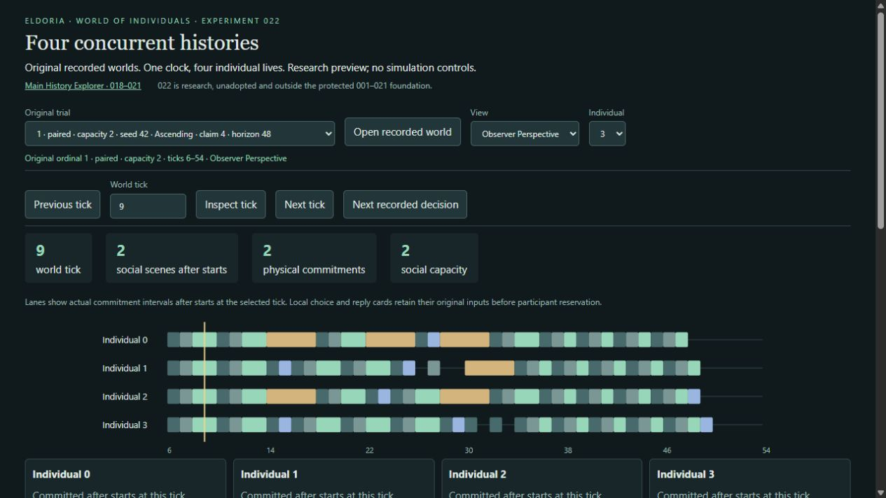

# Inspect an actual four-person concurrent history

Start the [read-only preview](../../tools/history-explorer/validation/concurrent-preview/acceptance.md)
with `python -B tools/history-explorer/concurrent_preview.py --port 8768`, then open
<http://127.0.0.1:8768/>. This is original zero-based trial **1**, `paired`, capacity2,
seed42, Ascending order, claim duration4, comparison ticks6–54. Select original1,
click **Open recorded world**, and inspect the ticks below. The archive SHA256 is
`f8d6c5b8de0d955bb316f89ec1dba11a0712311f9d45f49e3fb8e17fb1a0635c`.
The preview preserves that identity, not a generated narrative or newly run world.

## 1. Initial state and distinct prior histories: tick6

Each person starts this comparison with food2,hunger20; the finite cache contains4.
Earlier bootstrap interactions really occurred. The declared intervention sets
physical food/hunger before comparison while retaining those own social histories.
These are controlled initial conditions, not spontaneous pair formation. Switch
to Actor Perspective to inspect each person's captured input, excluding other
people's inventories and observer stock.

## 2. Four local choices

Observer Perspective at6 displays all four cards. Each considers all three
partners. Selected invitations are0→1,1→0,2→3,3→2, with contact scores96,64,108,64.
Open **Original recorded choice** for full candidates/ties, rather than treating
the chosen pair as a fixture instruction. Source: `boundaries[0].choices`.

## 3. Invitations occupy time: ticks6–7

Four Send commitments reserve each sender for one tick. A proposal is not consent,
and consent is not an executed resource action. All lanes use one world-time axis.

## 4. Independent recipient decisions: tick7

Each independently chooses Accept of its opposite sender, with Continue=0.
Scored recipient alternatives are original records, not inferred from eventual
encounters. Replies occupy7–8. Inspect **Original recipient decision**, or the
admission's **Original recipient reply**, such as `boundaries[1].responses[1]`.

## 5. Disjoint admissions: tick8

Arbitration admits commitment8 for0/1(scene2) and9 for2/3(scene3). Reverse
invitations have reciprocal records. Nobody is booked into both. Capacity1
original0 has the same pre-treatment conditions but cannot admit both scenes
here: the first treatment divergence.

## 6. Overlapping progress: tick9

Both scenes execute Offer, events6and7. There are two physical commitments on
one tick, rather than two extra global ticks.

## 7. Actual outcomes and releases: tick10

Actors1and3 Accept(events8and9). Each pair's balances change[2,2]→[1,3], conserving
food. Both commitments independently release at10. One need pulse changes all
four hunger values20→25. Two overlapping two-tick scenes advance the world by
two ticks. Event/release/need buttons provide exact original causal references.

## 8. Later voluntary decisions: tick10 and tick20

Tick10's input contains new inventories, episodes and directed trust. Actor0's
trust toward1 rises24→30, contact score96→108; actor1's trust toward0 rises8→38,
score64→124. This does not prove a different partner would be selected under
every counterfactual.

At20, event15 transfers1→3, across the actual prior pairs: [3,3]→[2,4]. Actor3's
next choice contains episode15, trust toward1=30 and selects Invite1(score108).
Source: `boundaries[14].choices[1]`. Other partners0and2 are busy; the gift is not
isolated as uniquely necessary for choosing1.

## 9. Persistent consequences and costs: through tick54

Inventory, hunger, directed trust and bounded memories persist into later choices;
worlds are not reset after divergence. Concurrent original1 ends with
food[0,0,0,4], compared with[0,1,0,2] in serial original0; hunger respectively
[40,35,10,5] and[40,5,80,5]. More scenes(18vs13) coexist with fewer meals(8vs9).
This is distributed benefit/cost, not universal superiority. See the complete
[results](../../experiments/022/results.md).

## Follow independent, negative and null histories

- Original5,tick10: first pair completed, second remains until11.
- Original0,tick15: Resource23(2/3),Claim24(0),Meal26(1) share one clock.
- Original15,tick10: one claim grants, competitor fails at full cost.
- Original11,tick5: busy recipient0 cannot supply invented consent.
- Original13,tick14,Actor3: a local Direct candidate is masked during claim16;
  neither executed inquiry nor proof of a deadline jump that would have occurred.
- Original18,tick8: query6–19 has no invented interior choice; need still advances.
- Original31,tick40: capacity-null history still has contact and growing hunger.
- Original33,tick196: empty stock/food, distinct hunger and owned dated receipts;
  closing affordability makes everyone Wait.

Explanations follow recorded causes. No fiction, institutions, global utility,
consciousness or naturally arising community is inferred.
