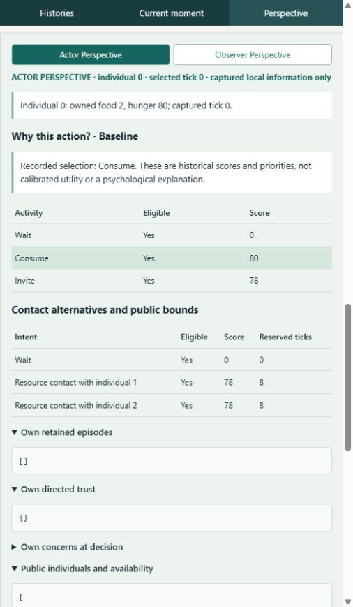
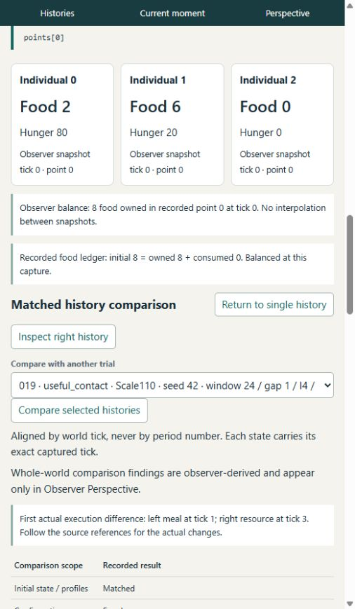
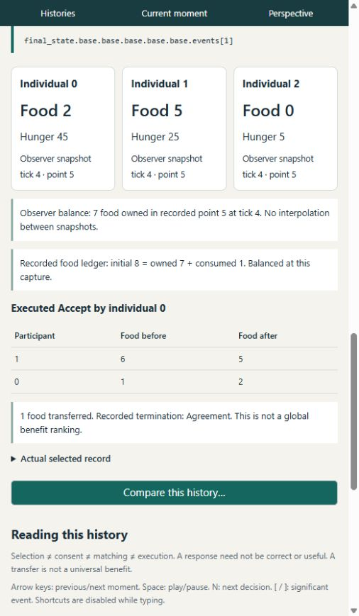
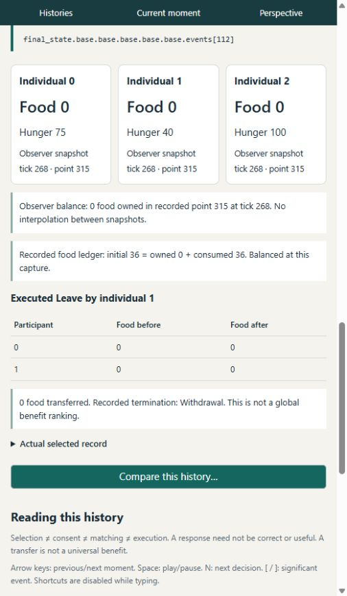

# Observing the recorded lives of Experiment 019

Observed on 2026-10-16. Scientific source and delivered viewer revision:
`bc15b4551e19455cf8545019213a04cc2ee9df2b`, initially clean and equal to origin/main.
The isolated viewer wording correction is `a7ae325`; no simulation rule changed.
This is a post-evaluation observational investigation, not a new experiment,
preregistered treatment estimate, or replacement for the qualified
[019 review](../experiment-019-review.md) and [protected contract](../experiment-contract-001-019.md).

The individuals have explainable immediate needs, independent consent and lasting
material and relationship consequences. Their world also supports long stretches of
activity that cannot relieve those needs. The strongest next behavioral question is
a finite, locally visible alternative source of food, with total potential supply
held constant. Better historical explanation should accompany that work. These
observations do not justify adopting a new score or retry mechanism.

## Evidence and method

I used the actual running application at [localhost](http://127.0.0.1:8765), not just
report summaries. Its original archive/member verification succeeded. I selected
all three individuals, read actual candidate scores and retained episodes, switched
Actor/Observer perspectives, followed resource and inquiry references, used tick
jumps and next-decision/significant-event navigation, inspected final states and
used all seven real-history comparison presets. The application is a read-only
consumer; no evaluator writer or new simulation was used to produce observations.

All references below are Experiment019, seed42. Record numbers are **one-based
JSONL ordinals**; period, step, point and event indices are **zero-based**. `C103`
means [seed-42.jsonl.gz](../../experiments/019/seed-42.jsonl.gz) record103; `H182`
means [held-out-seed-42.jsonl.gz](../../experiments/019/held-out-seed-42.jsonl.gz)
record182. Event `eN` is `final_state.base.base.base.base.base.events[N]` inside
that trial. These namespaces never identify an event in a different trial.

| UI investigation | Original records | Scope |
|---|---|---|
| A: useful contact | C103 Baseline / C107 Scale110 | First meal, consent, reversed encounter direction, all three lives |
| B: private cooperation | C109 Baseline / C113 Scale110 | Same initial focal input; different private source circumstances from A |
| Long ongoing history | C85 Baseline | Before exhaustion, ticks101/106/258/264/268/300/400/564/576 |
| C: delayed meal | H182 EatFirst / H183 Deadline | Tick16 choice, actual visit, multiple later boundaries, terminal reconvergence |
| D: missed inquiry | H7 Baseline / H10 Scale90 | Tick45 intention, arbitration, actual later queries |
| E: conservative admission | C103 / H49 Baseline | Window24 versus6 with equal initial physical/profile state |
| F: complete null | C7 Baseline / C10 Scale90 | Equal complete final Snapshot, no observed choice/execution difference |
| G: observation gaps | H139 / C1 Baseline | Gap5 versus1; fixed physics but different decision sampling |

These 14 histories were examined through the browser, with depth concentrated on
the first five rows. A separate [read-only extraction](../../tools/history-explorer/validation/observe019.py)
checks the original members without importing the viewer, evaluator or policy.
Its reproducible [evidence packet](history-explorer-observations-019/evidence.json)
contains original identities/digests, selected decision slices, resource actions,
period states, query/provenance records and explicit assertions. It checks food
conservation in all14 and independently integrates the four primary contact
pressure-time totals. Screenshots illustrate evidence; they are not its authority.
This selected sample supplies explanations and counterexamples, not a frequency
estimate for naturally arising communities. Seeds and deterministic replay do not
create independent statistical observations.

## Individual 0's first recorded choices

At C103, period0/step0, point0, tick0, individual0 owns two food and has hunger80.
It has no retained episodes, no directed trust, no active inquiry concern in this
input, and sees individuals0–2 publicly available until the window ends at24.
It does **not** see their food, generosity or caution. Its candidates are Wait0,
Consume80 and Invite78, all eligible. The two resource targets both score78 and
reserve eight ticks; stable ordering selects target1 within contact. The activity
selector chooses Consume. A contact candidate existing is not a contact being sent.

| Decisive reference | Legitimate input and choice | Actual execution and consequence |
|---|---|---|
| C103 p0/s0, observed0 at0 | Actor0: food2/H80, scores0/80/78; Consume | `consumption[0]` at1: food2→1,H80→40. No food is created. |
| Same step, sent point1 at1 | Actor1 independently selected Invite0 at0. Actor0's **new response input** has food1/H40; Accept invitation1 scores48 versus Wait0 | Provisional acceptance; allocation at point2/tick2 executes **1→0**, scene0, start2. Step after-point3 is at2. |
| C103 e0 at3; resource advancement p0/s1, points3→4 | Actor1: food6/H20; Offer90 versus Request−15/Leave0 | Offer is observed, not yet a transfer. |
| C103 e1 at4; advancement p0/s2, points4→5 | Actor0: food1/H45, observed Offer; Accept61 versus Refuse2/Leave0 | Agreement: participants[1,0], balances[6,1]→[5,2]; one food moves1→0. |
| C103 p0/s3, point5 at4 | Actor0 now food2/H45, trust1=24; both0/1 select invitations | Reciprocal invitations; arbitration executes **0→1**, scene1,start6. |
| C103 e2 at7, e3 at8 | Actor0's Offer score76 includes trust24 and recent episode contribution24. Actor1 then Accepts | The earlier beneficiary offers food back: balances[2,5]→[1,6]. Experience already affects subsequent scores. |
| C103 period0 after-point28 at24 | Carried state, no reset | Food[0,4,0],H[30,5,30]; trust0→1=54,1→0=70. |

Hunger rises by5 at completed four-tick intervals and falls by up to40 per meal.
That explains H45 at the tick4 acceptance after the earlier meal. The meal and
later contact do not compete as two simultaneous choices by actor0: actor1's
independent invitation arrives after actor0's meal and gets its own response.

**Demonstrated:** eating, receiving, giving back and accumulating directed trust
are executed state changes with later use. **Explanation:** current food/hunger,
retained episodes and trust enter existing selectors; consent, matching and the
resource protocol mediate execution. **Uncertainty:** this establishes no friendship,
gratitude, conscious intention or knowledge of another's private circumstances.
The archive records interpretations and numbers, not hidden feelings.

## A small priority change changes several histories

C103 and C107 have identical initial states, profiles, configuration and captured
actor inputs. Scale110 scales the eligible top invitation score with integer
truncation: 78×11/10=85. Consume stays80, so actor0 selects Invite1 at0.
Within-contact target ranking is unchanged. Actor1 still invites0, actor2 Waits.
Scale110 applies to every eligible actor: actor1's invitation score is107 rather
than98, although its first selected activity is unchanged. Actor0 is the first
choice divergence, not the only individual exposed to the policy intervention.
Both0/1 provisionally accept the other's proposal at1; deterministic arbitration
executes0→1 and marks1→0 Reciprocal. This is a change in **execution direction**,
not in the direction of the eventual food transfer.

C107 scene0 starts2, e0 at3 is actor0 Request (food2/H80); e1 at4 is actor1 Offer;
e2 at5 is actor0 Accept. Balances[2,6]→[3,5]. Actor0's first meal occurs at20,
not1 (`periods[0]` consumption records). More invitations do not imply earlier
need relief. Subsequent scores, resource protocol direction, meals and public
availability all evolve from these real differences; the modes are not reset.

| State or outcome | C103 Baseline | C107 Scale110 |
|---|---|---|
| First voluntary difference | Consume at0 | Invite at0 |
| First executed difference | Meal at1 | No meal at1; Request at3 |
| Tick24 captured points | 28: food[0,4,0],H[30,5,30] | 28: food[1,2,0],H[5,5,30] |
| Tick48 | point56:H[60,5,60],food[0,2,0] | point57:H[10,5,60],food[0,0,0] |
| Tick72 | point84:H[90,5,90] | point86:H[40,35,90] |
| Actual transfers | 12 | 6 |
| Meals by individuals0/1/2 | 2 / 6 / 0 | 4 / 4 / 0 |
| Pressure-time0/1/2 over[0,144) | 10960 / 4505 / 10200 | 8355 / 6685 / 10200 |
| Final tick144 | point197:all food0,H[100,95,100] | point173:all food0,H[100,100,100] |
| Final trust1→0;2→0 | 100;−33 | 81;0 |

Individual0 gets more of the eight total meals and lower accumulated modeled
pressure. Individual1 gets fewer meals, higher pressure and higher final hunger.
Individual2 gets no food in either history and identical hunger pressure, but its
relationship history changes: it executes a Request in each, and the later
Refuse/Leave path gives different final trust. Its invitation selections also differ
(25 versus27); that is not a count of successful meetings. Actor0 activity counts
are Consume2/Invite26/Wait30 versus4/29/23; actor1 is6/26/28 versus4/28/26.
Different commitment schedules mean these counts are not matched independent trials.

**Demonstrated:** a10% score intervention can change consumption timing, recipient
response context, matching, transfer direction within negotiation, ownership and
lasting distribution/relationships. **Explanation:** hunger first changes one
choice; independent consent and arbitration change which protocol runs, and
actual transfers/interpretations change later local inputs. **Uncertainty:**
continuing policy treatment and feedback prevent assigning every later difference
to a single isolated meal or belief. **Limitations:** three actors, externally
reopening windows, Continue0 recipient control, mixed score units, finite stock
and inherited interpretation rules. Fewer transfers and lower pressure for one
actor do not supply a global welfare ranking or justify Scale110 adoption.

## Same local choice, privately different cooperation

The entire captured initial actor0 input is equal across C103/C107/C109/C113,
including its public people, own traits/profile and local query projection.
Between useful and unproductive fixtures, source1 changes generosity100→0 and
caution0→100; its initial food6/H20 is unchanged. Both traits change together.
These private circumstances belong to source1, not to actor0's perspective.

At C113 p0/s0, actor0 again selects Invite at85 over Consume80. Source1 instead
selects Consume, eats at1 (food6→5,H20→0), then independently chooses Wait against
Accept0 score−2. Allocation at2 is Declined, not a completed resource encounter or
failed transfer. Subsequent initial offers of contact also fail; source1 consumes
again at5 and9. Actor0 does not eat until18/19, whereas C109 eats at1/10.
The first actual resource event is a different encounter: actor2 Leaves in scene0
at11 (C113) versus12 (C109), not source1 fulfilling the original invitation.

Neither private mode transfers food. Both ultimately consume2/6/0 units and end
food0/H100 for everyone. Actor0 pressure-time nonetheless worsens10640→11680;
actor1 changes8260→8250. This is a reversal of the useful fixture's apparent focal
gain. **Yes: the same locally informed choice can meet different consequences
because another individual acts from independent private circumstances.** It is
not evidence that actor0 knew a source was unwilling or empty, and it does not
identify generosity alone as the causal private factor.

## A busy world after food runs out

C85 is ongoing/Baseline, not the similarly named longitudinal case. It carries24
windows from0 to576, initially12 food and H20 per person. The first captured
all-zero inventory is **point304 at258**. The last meal is actor0's at258,
`periods[10].steps[13].activity.consumption[0]`, food1→0,H100→60.
At point303/tick257 that unit still exists. Point304 has H[60,25,100]. The ledger
is initial36 = owned0 + consumed36; meals distribute7/17/12 across0/1/2.

Before exhaustion, actors0/1 repeatedly trade while actor2 eats independently.
Actor2 executes no resource action in the entire history despite110 selected
invitations. At101, p4/s4, point120, actor0 food1/H100 chooses Invite133 over
eligible Consume100. The selected0→1 scene19 starts103; Request e43 at104,
Offer e44 at105 and Accept e45 at106 **really obtain one food**.
At106, p4/s8, point126, actor0 now food2/H100 chooses Invite188 over Consume100.
Scene20 then executes its Offer e46 at109 / actor1 Accept e47 at110: a unit goes
back. These moments cannot both be labeled useless requests.

Why133 and188? Existing contact valuation takes the maximum currently legal
resource-action score against a hypothetical partner signal, adds half own hunger,
and subtracts2. At101, Request85 wins, so85+50−2=133. At106, last-food scarcity
protection no longer applies to food2; Offer140 wins, so140+50−2=188.
Trust100 and recent episode contribution40 help make Offer140. This scalar is
neither expected food gain nor a calibrated probability of cooperation. The
admission decision sees public availability, not source inventory or a future reply.
See [resource scores](../../src/behavior.rs), [contact valuation](../../src/encounters.rs)
and [priority control](../../src/priorities.rs). Eating was legal at both moments.

Empty-source encounters already occur before global exhaustion: e109 Request at256
and e110 Leave at257, scene45, before actor0 eats its last unit. After258:

| Mechanism counted separately | Exact observation in C85 |
|---|---|
| Executed resource actions | 130: **65 Requests by0 and65 Leaves by1**; no Offers, Refusals or Accepts |
| Completed resource encounters | 65 distinct scenes46–110, each ending Withdrawal; zero transfers |
| First such encounter | p11/s0 selects at264, point310; starts266; e111 Request267, e112 Leave268; after-point315 |
| Later examples | p12/s9 at300: e127/128 at303/304; p16/s12 at400: e169/170 at403/404 |
| Last encounter | p23/s12 selects at568; e239/240 at571/572; final period552–576 ends point687 |
| Allocation dispositions for steps observed at/after258 | Execute65, Reciprocal65, Declined65. These are invitation dispositions, not195 encounters. The third actor's proposals are Declined. |
| Final physical state | All food0,H100 at576; no late replenishment or transfer |

At258–263 actors Wait because fewer than eight ticks remain in that window, even
though people are publicly available. At264 a new window restores eligibility.
At300/400/564, actor0 food0/H100 chooses Invite133 (partner1) over Wait0;
Consume is ineligible. Partner2 scores108. At400, p16/s12 point475, actor0 retains
16 episodes, events153–168, alternating RequestHeard/Departure, all valence0;
trust1 remains100. Recent outcomes are **not forgotten**, but their interpreted
valence does not reduce trust or the Request-based contact value. At264 its retained
episodes also include three preceding Departures106/108/110. The policy has no
stock estimate that a Departure could update, and Departure does not state a reason.

The recipient's local choice matters too. At e112/tick268, individual1 has food0/H40;
Offer is illegal, Refuse scores−50 and Leave0 wins. At e170/tick404, food0/H100,
Refuse−20 again loses to Leave0. Thus the protocol terminates without the negative
Rejected interpretation that a formal Refuse could produce. This explains the
observed zero-valence loop without asserting that either actor disclosed its shortage.
Earlier positive episodes can be evicted while separately persistent trust100
legitimately survives. That is the protected legacy forgetting exception, not
observer-history recovery or a defect to repair by erasing trust.

Three explanations apply at different levels:

* **Information limitation, demonstrated boundary:** own emptiness and observed
  unsuccessful encounters are local; other inventories are private. A Leave does
  not prove emptiness, future inability or hostility. Observer certainty that all
  food is gone cannot be given to actor0 as its explanation.
* **Decision-policy limitation, demonstrated mapping:** recent zero-yield episodes
  remain available, yet the present heuristic repeatedly ranks contact above Wait.
  Old positive trust persists; the last-four zero valences neither erase it nor
  provide a separate expected-yield estimate. This explains repetition mechanically.
  It does not prove that a replacement would improve behavior: waiting cannot
  manufacture food, and suppressing retries could miss a newly useful source.
* **Environmental limitation, demonstrated absence:** with all inventories empty,
  this world has no acquisition/production channel. Its activity menu is Wait,
  Consume or Invite; inquiry requires an unresolved local concern. No possible
  redistribution can create a meal. Hunger saturates without a death mechanism
  in these histories. More successful contact alone cannot repair this constraint.

Their relative importance to *better achievable outcomes* is not isolated here.
A prospective controlled study would cross finite access with unchanged versus
explicitly local feedback controls, hold total potential food/time constant, and
include recovering and permanently empty sources. Measure useful allocation,
missed cooperation, meals, wasted time and later exhaustion separately. Existing016
feedback research already warns that fewer declines do not imply useful allocation;
do not reinstall Typed as an observational fix. No such study was run here.

## Negative, null and timing witnesses

**Delayed meal, H182/H183.** The full prefix matches until16, p0/s12, point19.
Actor0 food1/H5 has eight ticks left. EatFirst chooses Consume despite the recorded
Invite112 score; Deadline chooses Invite because a meal plus bound8 would not fit.
Its selected outgoing0→1 is Declined. The actual allocation is2→0, starts18, and
actor2 Leaves at19, e6, without a transfer. EatFirst's meal is17,5→0; Deadline's
is20,p0/s14,10→0 after the next pulse. Removing an extra five pressure points
explains the temporary advantage. H at24/48/72 is[10,40,70] versus[5,35,65] for0;
the difference still exists at96 and disappears at100. This is not useful social
information or smarter cooperation. Both complete final Agent arrays match,
including trust and retained memories. The final Snapshots differ in events/scenes
and `cognition.consumption` audit records; final beliefs/information match. Calling
that remaining difference a demonstrated persistent cognitive advantage would be wrong.

**Planned versus actual inquiry, H7/H10.** At45,p0/s3, observed point7, actor0 has
food4/H35. Invite38 (Inquiry2) beats Consume35 under Baseline, while scaled34
loses under Scale90. Baseline arbitration instead executes2→0 Resource at47;
its planned0→2 inquiry is Contention and `query=null`. Actual e6 Offer48/e7
Refuse49 are resource events. Later p0/s6 admits an actual **actor2→source1** Direct
query in Baseline, observed51/completed63, concern3 stays Open and receives no
receipt. Scale90 instead admits **actor0→source2**,51–64, inquiry0/provenance
query0, receipt1; assessment record1 adds quality50 to the retained quality20 basis,
support20→60 and concern0 Partial→Resolved. Later inquiry1,67–79, is unproductive.
The native response field is null even in the successful provenance delivery;
that field alone cannot classify information gain. The narrow viewer correction
labels this explicitly. Neither an unexecuted plan nor a native null proves learning.
Continuing treatment, matching and feedback confound attributing all material
differences to the belief change alone.

**Conservative admission, C103/H49.** Initial physical/profile state matches, but
the public window ends24 versus6, so local inputs differ legitimately. At H49
p0/s0, point0, resource bounds8 make both targets ineligible (score−1). The C103
Offer/Accept episode finishes at4, retrospectively fitting6. This shows a conservative
exclusion, not a scheduler correctness bug or an actor's knowledge of future duration.
It does not show every excluded contact would be useful or finish in time.

**Complete null, C7/C10.** At final144, point173 in both, all inventories0/H100;
the entire final Snapshot is equal, with no observed voluntary/executed difference.
Different policy names do not establish a behavioral effect. This is stronger than
H182/H183's material/Agent reconvergence but is not an assertion that every Trial
candidate-score audit is byte-identical.

**Sampling, H139/C1.** Gap5 versus1 retains shared physics and total horizon but
changes actual decision times (first schedules differ at5 versus1). UI gap records
explicitly mark intervals with no decisions. Meal/pulse alignment changes pressure
without a better valuation estimate. This timing comparison is not a pure isolated
policy choice; concern age and arbitration wave phase can also change.

## What is understandable, artificial or unobservable

| Classification | Finding and evidence |
|---|---|
| Demonstrated strength | Immediate eating relieves actual modeled hunger; C103 meal1 is accounted, then independent recipient consent permits later help. |
| Demonstrated strength | Past experience changes real subsequent scores and trust, C103 e1→e2; asymmetric histories distinguish individuals. Persistence is not universal improvement. |
| Demonstrated strength | Private independent decisions change outcomes under identical focal input, C107/C113. Actor and observer explanations can remain separate. |
| Demonstrated strength | Existing independent consumption occurs while others negotiate, C85 actor2's meals; simultaneous disjoint social encounters are not demonstrated with three actors. |
| Demonstrated limitation | C85 becomes a finite exhausted world with no material recovery channel, yet continues65 complete zero-yield contacts. |
| Demonstrated limitation | Activity scores mix hunger, trust and immediate resource-action scores; C85's Offer-based188 outranks eating100 without forecasting net need relief. |
| Possible design weakness | Reopening public windows cause waiting258–263 then renewed invitations264. This is externally supplied opportunity geometry, not an identified scheduler bug. |
| Possible design weakness | Persistent trusted dyads and consent/order repeatedly exclude actor2's invitations in C85. Effects under more actors, other orders and access are not isolated here. |
| Observation limitation | Full retained Grouped basis and separate Contextual progress cells are absent from activity inputs. Atomic inquiry has no internal actor snapshots. Observer audits cannot retroactively fill them. |
| Future possibility | Finite access could give a non-social alternative and alter cooperation; whether it improves any actor's life remains untested. Richer activity or game-facing life simulation is further away. |

Interpreted as a tiny community, this is a world of immediate need relief,
redistribution, remembered encounters and repeated invitations. There is no evidence
for a rich daily purpose beyond its small menu. Saturation can flatten terminal
numbers while earlier lives differed greatly. No actor's lack of food reveals a
belief about all other inventories, and no transfer establishes friendship or fairness.

Unexpected details were especially instructive: food obtained at106 can go back at110;
actor2 can spend its entire stock while never executing one resource action;
16 fresh failure-related episodes can coexist with trust100; identical final Agents
can conceal different consumption/event histories; and a native null response can
coexist with genuine provenance-delivered information. These are concrete model
distinctions that aggregate totals alone make easy to overlook, not newly discovered
experimental treatment effects.

## Explorer assessment and development decision

The Explorer made the investigation practical and exposed the native-field labeling
problem. Seven usability observations emerged from actual use:

1. Named presets and verification metadata make authentic cases easy to open.
   Long identity labels and repeated record ordinals across archives still require
   expanding provenance; stable deep links would improve reproducibility.
2. Actor/Observer labels and explicit missing information are valuable. Clicking an
   observer reference switches perspective; readers must notice that transition.
3. Actual score tables explain selection well. A reader still needs a short linked
   explanation of why contact133/188 is not expected food gain, and why EatFirst can
   select a score5 meal over Invite112.
4. Tick jumps land on the first moment at that tick, often a need update. At45/106/268
   I needed Next decision or Next event. Same-tick phase navigation is scientifically
   important but requires instruction.
5. Selected invitations, consent, allocations and resource actions are separate
   inspectable records, but following them across cards/disclosures is laborious.
   Typed causal links and a continuous per-person view would help without inventing
   cognition or treating adjacency as a sufficient cause.
6. Long traces remain navigable with bounded lists, yet finding repeated zero-yield
   encounters required resource filtering, several tick jumps and original extraction.
   A derived scene-level filter should distinguish Request/Leave, Refuse and Declined.
7. Trust and memory disclosures show surviving state, but comparing changes across
   events is manual; the viewer has no compact trust/food trajectory or typed native-
   versus-provenance delivery explanation. Large pair loads can leave a loading
   status for several seconds; no speed estimate was measured during this review.

For a non-programmer, the plain score and balance tables are readable, but nested
JSON, period/point namespaces and native-versus-provenance channels still need the
guided explanation. The current interface supports investigation with assistance;
this session does not establish independent novice usability.

The [ranked backlog](post-019-observation-backlog.md) recommends small observational
improvements alongside a prospective finite-acquisition study. The existing
[scope proposal](resource-acquisition-scope.md) remains a starting hypothesis; its
pre-review wording about unprotected019 is historical and superseded by the current
contract. Acquisition is the strongest next **behavioral** candidate because an
exhausted world has no physically meaningful path to more meals. It would be a
transfer from finite unowned stock, not free replenishment or sustainable production.
Its scoring, access observation, contention and attempt-time semantics must be
specified prospectively; no exact cost or formula is approved here. Its value
versus better feedback cannot be decided from these histories alone.

## Verification and scope of changes

The [walkthrough](history-explorer-first-walkthrough.md) reproduces the UI steps.
Four genuine screenshots accompany the evidence packet. The separate
[label correction record](../../tools/history-explorer/validation/inquiry-label-review.md)
documents the one display-only fix. Affected navigation links and this checkpoint
are updated; no original results, contract, archive, Rust runtime, scoring, hunger,
canon or default changes are part of this investigation. No020 was created.

Validation results are recorded in the [checkpoint](../working-checkpoint-observations-019.md).
The independent reader reproduced the evidence packet exactly (exit0); the original296
working-byte guard passed. `cargo run --release --locked -j 1 --example validate_contract`
exited0 through001–019, including019's1296 exact worlds,336 raw full histories,
four independent readers and296 protected artifacts. Local Markdown links,
source identities, Python AST/JSON and working-tree scope checks passed.
For this documentation/read-only-tool scope, Rust formatting, Clippy, tests and
throughput benchmarks are not rerun: no Rust, fixtures or dependencies changed.
The foundation replay remains independent of the viewer. The viewer Python suite
passed16 tests (exit0); JavaScript syntax/owned-state checks exited0;
actual browser empty/successful inquiry checks verify the new label. No performance
improvement or new behavioral conclusion is inferred from those engineering checks.
