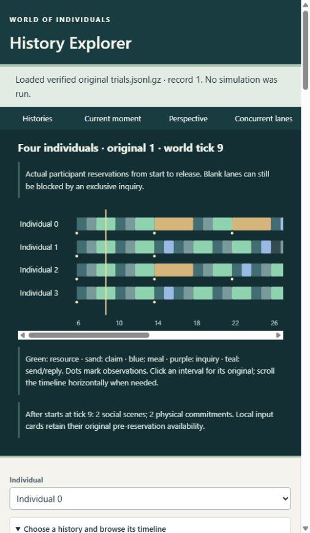

# Main History Explorer native022 acceptance

Gate C: PASS. Main8765 application loads authentic native022 originals and displays
four individuals, overlapping actual commitments, owned decisions, independent
recipient inputs, typed causal chains and source-verified capacity comparisons.
No scientific conclusions depend on this display adapter.

Launch: `python -B tools/history-explorer/explorer.py`. Choose an022preset, then
Observer Perspective for lanes and comparison. Use **Inspect right history** for
capacity2. Individual0-3 and Actor Perspective expose only exact owned captures.
Original references retain zero-based trial ordinal and unmodified trial schema.
No fake021 clock or periods are inserted.

Actual in-app browser acceptance (not screenshot-only or separatepreview):

| Case | Authentic original / observation |
|---|---|
| Two scenes | 1@9: two disjoint social scenes; original0@9 has one |
| Separate finishes | 5@10: 0/1 released and sending; 2/3 stays committed until11 |
| Mixed work | 0@15: Resource23(2/3), Claim24(0), Meal26(1) |
| Busy recipient | 11: unavailable allocations at5; no invented reply by busy0 |
| Legitimate refusal | 35@100: scene43 individual1 executes Refuse; owned food0/hunger100, scores11 vs Leave0 |
| Depleted claim | 15@10: finite cache0 after competing claims; grants/failures are separate original records |
| Atomic restriction | 20: AtomicBlocked6/8/10; 18@8: sole query0/2 interval6-19; no actor input filled at8 |
| Complete null | 30/31: no admission/event/choice/food difference; terminal food/hunger/trust equal |
| Long history | 35@100: zero cache, high hunger, continued costly contact; no phantom replenishment |
| Mixed consequences | 2/3: meals, claims and social work differ; per-person outcomes preserved |

All four owned opening choices of1@6 inspected:96/64/108/64. Actual recipient3@7
has own state and Accept2 score64 vs Continue0, no environmental slot backfill.
The0/1comparison separates admission8, execution9, missing opportunity8 and common
actor/tick choice16; temporary food equality12 does not erase later divergence.
Exact typed links lead from selected cohort through replies, commitments, resource
events and release. Later availability links are labeled context, not unique motive.
Returning to021clamps actor3to0 and disables3. Browser console has no warnings/errors.
Narrow viewport screenshot verified legible contrast and horizontal axis scrolling
after a visual correction. An initial automation attempt only changed the library
selection; it did not click Open. Its observations were discarded. The saved
acceptance records wait for each actual loaded-original status.

Automated: full48Python tests (41legacy+7native), four separatepreview tests and
four legacyJavaScript suites PASS; nativeJavaScript runs through Python against
actual exports. All50comparisons reproduce15terminalfood,20hunger,31semantictrust
differences and9fullnulls. Imports rebuild poisoned projections and reject changed
originals/source locks; localHTTP denies run and foreignOrigin. Seven native tests
repeated after finalcomparison changes PASS. Task temporary logs C-checks.json and
C-native-final-tests.log. No Rust or historical behavior changed during C;
Bactualvalidation/source fingerprints apply.

[Measured cost](main022-viewer-cost.json): 100entry source-verified catalog2.852s;
selected original1 load0.062s/export946348bytes, long35 load0.308s/export4927474bytes.
Decoded member cache capped at2. Encoded size is not live heap; single sequential
samples on this host, not scalability or speedup evidence. Only selected histories
enter the browser; observer-derived intervals/physical vectors never enter cognition.

[Browser record](continuous-world-browser/main022-acceptance.json).

Files: main adapter/frontend, tests, viewerREADME and navigation. Scientific022
archives, source freeze and001-022foundation originals remain unchanged.
