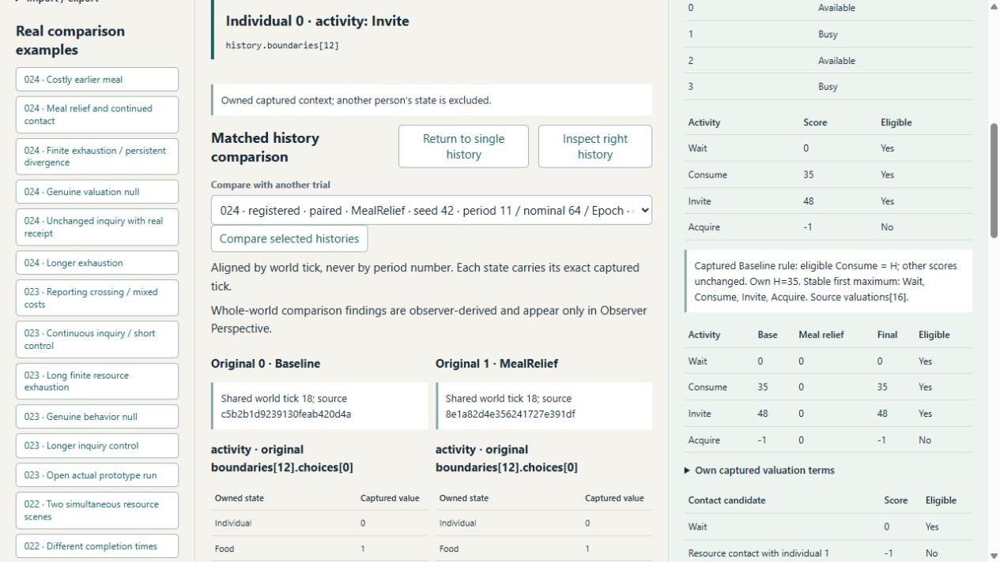
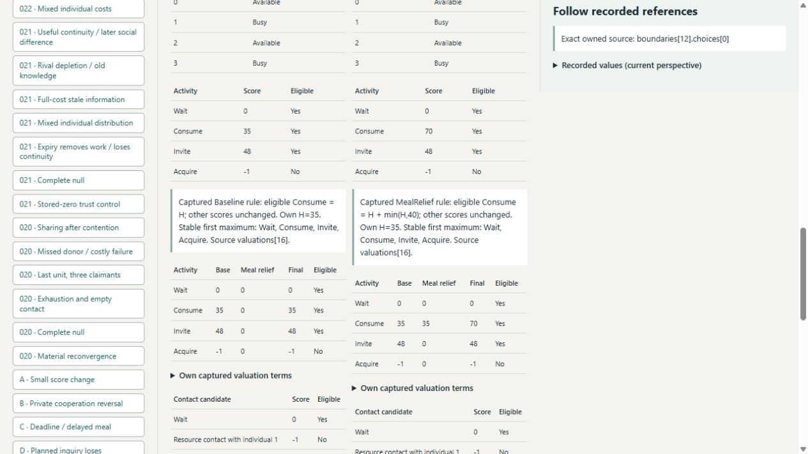

# Main History Explorer 024 acceptance

The main application supports explicit, read-only Experiment 024 originals through
`tools/history-explorer/valuation_history.py`, extractor version 8. Its shared
primitive presentation keeps the original 024 physical schema. The old 023 adapter
remains version 7 and unchanged. This does not adopt any simulation policy or
extend the protected foundation.

## Executed verification

- Eight targeted 024 Python tests passed in 56.277 seconds.
- The complete main viewer suite passed: 65 tests in 333.689 seconds, including
  historical schemas, source verification, HTTP write rejection, lossless import,
  privacy, actual JavaScript projections and the new 024 comparison checks.
- All 56 original 024 members round-trip losslessly, retain correct final timeline
  IDs and resolve original timeline references. All 27 matched comparisons reproduce
  scientific choice, terminal food/hunger/trust and hunger-area results.
- Deferral checks require owned food, eligible consumption and an actual
  positive-duration commitment; they reject interpreting an unavailable meal as
  deferred. The empty-food null has no such records.
- Scratch source edits, wrong schemas/bonus/references, missing audits and modified
  imported originals are rejected. Derived poison is discarded and rebuilt.
- Actual JavaScript tests check same-input tick18 scores, exact audit references,
  other-person/observer mutation independence, absent checkpoint cognition and
  exclusion of later response context from actor inquiry selection.
- Standalone perspective, causal, finite and knowledge JavaScript suites and both
  changed JavaScript syntax checks passed. A logging wrapper hit Windows console
  encoding after three successful suites; remaining checks completed with escaped
  output. No JavaScript test failed.

Logs are under `%TEMP%/activity-valuation-024/I-*`. Durable verification records
bind the executed checks and viewer source revision. No simulation-source or
scientific archive was changed for this milestone.

## Actual browser acceptance

The local main application was launched with both authentic 023 and 024 sources
and the actual prior custom 023 demo: 913 catalog entries. The original tab had a
cached connection-error page after server restart; a fresh tab in the same selected
browser recovered correctly. No security setting or browser was changed.

Browser inspection verified:

1. Pair 0/1: matched captured input at tick18, own food1/H35, Baseline Consume35
   versus Invite48 and MealRelief Consume70. Actor comparison excludes whole-world
   findings, and a non-decision record supplies no invented owned input.
2. Following the right first execution link opens original ordinal1's
   `history.final_state.base.base.base.base.base.cognition.consumption[2]`:
   actor0, tick19, food1→0, H35→0.
3. An actual post-meal social transfer opens ordinal1 event15 at tick20:
   participants1/3, Accept, balances[3,3]→[2,4], transferred1, Agreement and
   HelpGiven/HelpReceived interpretations. This is not a universal welfare label.
4. Null20/21: no first choice/execution/material difference, equal complete
   physical/history bodies, equal terminal trust and zero hunger-area differences.
5. Inquiry12: actual Direct inquiry0 completes at19 after13ticks, native response
   null, novelty40; typed links separately follow provenance receipt1 and cognitive
   receipt0. Actor selection excludes later response/delivery context.
6. Exhaustion18/19: first choice14, execution15, terminal food/trust divergence but
   equal terminal hunger; area deltas[-2070,0,-2640,0]. Baseline actor2 at72 owns
   food1/H100 yet selects Invite132 above eligible Consume100, with a locally
   retained stock0 receipt rather than current observer stock.

Raw browser observations are saved in
[observations.json](activity-valuation-024-browser/observations.json). The captured
screenshots are actual rendered pages, visually inspected for correct text and
context. Browser inspection caught an edit-time punctuation encoding regression;
it was corrected before full viewer tests and acceptance captures.

## Cost and limits

A separate otherwise idle Python measurement indexed 56 originals in 6.143 seconds
with a fresh derived repository and warm OS file cache. Verify/project times for
ordinals0/1 were about0.102/0.097seconds; serialization about0.025/0.024seconds.
Their exports are1.66/1.60MB. Ordinals52/53 take1.54/2.24seconds to verify/project
and0.33/0.44seconds to serialize, producing22.99/30.90MB exports and7,033/7,236
timeline records. Both source-member and derived-export LRUs retain at most two.
Actual values are in [performance.json](activity-valuation-024-browser/performance.json).
These measure observer projection/serialization, not browser frame rate or live
cognitive heap. Large histories still cost time, storage and browser memory.

The UI is an authentic source consumer, not a substitute scientific validator.
No live tuning, inferred motive, nearest-state interpolation or archive recovery
is offered. Actor calculations come from the owned decision and its exact scalar
audit; actual time and later consequences are separately labeled observer facts.
The first score difference can leave behavior unchanged, and first execution
links can legitimately exist on only one side. Material reconvergence does not
erase recorded cognitive/social history. Preparation is not implemented.
