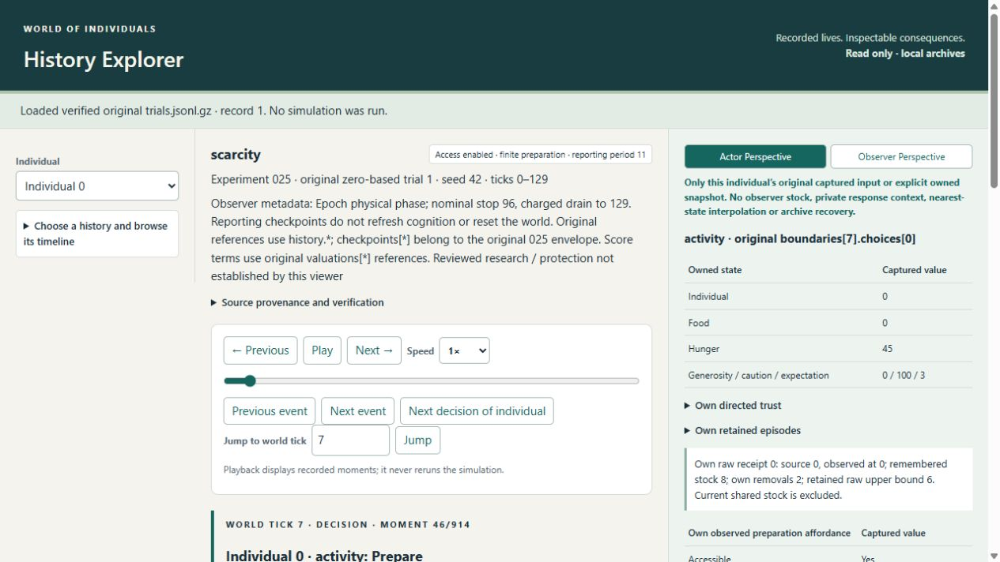
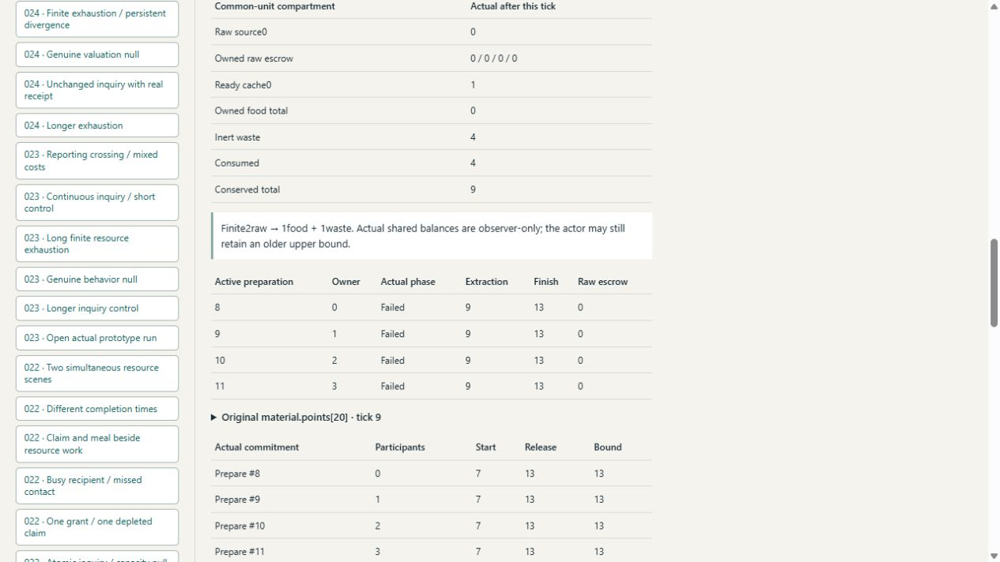
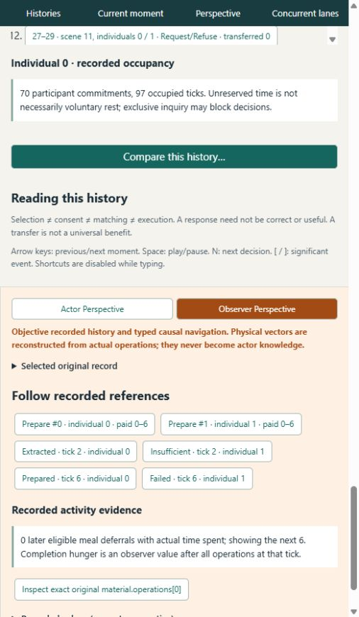

# Main History Explorer025 acceptance

The explicit read-only025 adapter is complete for the received scope. It does not
execute policies, extend the foundation beyond024 or adopt preparation as a default.
The continuation supplies detailed I3–M and final acceptance. Supplemental coverage
below addresses it without new simulation outcomes.

## Verification

- Complete main viewer suite:72 tests PASS in344.603seconds, covering older
  schemas019–024 and025, actual JavaScript projections, source identity, imports
  rebuilt from originals and HTTP mutation rejection.
- After browser-discovered025 comparison/order refinements, all7 targeted025
  tests passed again at the final adapter revision in58.758seconds. Both changed
  JavaScript files pass Node syntax checks. Older adapter defaults remain intact.
- All50 original025 envelopes round-trip losslessly; every timeline/node/edge
  reference resolves.24 matched comparisons agree with independent scientific
  edible-holdings, hunger and trust findings. Full conserved mass is separate.
- Actual JavaScript checks reject observer/other-owner poison, RawBefore recovery
  and invented actor inputs at material/checkpoint records. RawAfter is owner-bound.
  A remembered upper bound remains stale until a legitimate new observation.
- Same-tick physical operation order follows original numeric vector sequence,
  with exact linked memory updates. Browser inspection found lexical10-before8
  ordering and a comparison that included consumed units in edible holdings; both
  presentation defects were fixed and regression-covered. Scientific data never
  changed. The source158/old114/helper24/JSON4/foundation107 checks still pass.

Logs are under `%TEMP%/finite-material-preparation/K-*`. Scientific verification
remains the independent `validate025_evidence` gate, which passed50 full checks,
22 corruption controls and50 exact Rust byte replays; viewer tests do not replace it.

## Actual browser acceptance

The existing local main application now includes authentic023,024,025 and the
previous custom023 demo:963 catalog entries. Seven025 presets are available.
No browser security setting was changed. The active tab is left at original1,
individual0, world tick7, Actor Perspective. Browser error log is empty.

1. Pair0/1: first selected choice0, first executed extraction2, edible difference6
   and edible reconvergence7. Terminal edible holdings match; full material and
   trust can remain different. Waste is not mislabeled edible benefit.
2. Right first execution opens `material.operations[0]`: actual extraction at2.
   All-four after-tick view has raw0, escrow2 each, ready cache1, common mass9.
3. Individual0 chooses Consume85 over Invite65 at6; actual meal7 removes one food.
   Its next same-tick decision owns food0/H45 and still has receipt0 from0, remembered
   stock8 minus own2: upper bound6. Prepare39 beats Invite20. The observer knows
   raw0; Actor Perspective does not import that fact.
4. At9 the failed attempt has a fresh zero-stock receipt, no output, and continues
   paying through13. Actual phases/IDs follow original operation8 before10.
5. Costly sharing16/17: right actor2 at16 owns food1/H30 and chooses Invite120
   over Consume30. Event13 at20 records actor3 Accept35 versus Refuse−34, incoming
   balances[1,2]→[0,3], transferred1. Recipient already owns2 and H10. Actor2's
   paired hunger-area delta+2040 is a real cost; the whole delta is not attributed
   uniquely to that transfer and no universal welfare ranking is asserted.
6. Unknown-source2/3: no choice/admission/execution/edible/full-material differences,
   equal complete physical/cognitive history and zero hunger-area deltas.
7. Cutoff26/27 at nominal tick3: raw0, owner0 escrow2, other escrows0, ready1,
   food0, waste0, consumed0, mass3. Actual work remains Preparing/Failed until6;
   no premature food or reset at the checkpoint. Conversion is separately later.

Screenshots are actual rendered pages, visually checked in the browser:

## Limits and custody

The consumer verifies158 frozen sources plus compressed/decoded/member hashes.
Source/export LRUs each cap at2. Large histories still require substantial observer
projection/serialization and browser memory; no browser heap or frame-rate claim
was measured. The scientific replay/storage measurements are separate.

References `material.*`, `valuations[*]`, `checkpoints[*]` resolve in the original
envelope; `history.*` resolves in its original physical body. Typed work/receipt
links support chronology without inventing a unique motive or fungible food identity.
Later input can be same-tick after a different phase; strict later-tick records
remain separately labeled. Actor perspectives never use the observer ledger to
recover a replaced slot. No archived original was edited for UI acceptance.

## J8: completed continuation acceptance

The refreshed server preserves963entries. New comparison rows separately identify
fixed policy, initial received knowledge apart from access flag, first conversion,
first actual meal and first interpersonal event. All24primary contrasts test
matched policy/starting knowledge; raw access flags remain a disclosed intervention.

| Required actual browser check | Original checked outcome |
|---|---|
| 1 successful extraction/preparation |1:extract2/convert6/food1, exact original refs. |
| 2 finite depletion |1:raw8→0 after four actual extractions; no refill. |
| 3 failed paid extraction |1:choice7/failure9/release13, no output, new local receipt. |
| 4 competing attempts |5:two work0–6, extract2 one Preparing/one Failed; common mass3. |
| 5 report crossing |31:checkpoint4 has escrow2each, food0; converts6. Checkpoint Actor view reports no owned decision. |
| 6 occupied recipient |5:actual2→0 proposal unavailable2, while owner0Prepare0–6 and actors2/3Send. No guaranteed beneficial counterfactual. |
| 7 actual later consumption |1:Consume choice6, executed meal7. |
| 8 actual later transfer |17:event13@20, actual balances[1,2]→[0,3], independent Accept35. |
| 9 actual non-use |27at36:food1/waste1/consumed0/escrow0, mass3; no later ordinary opportunity. No voluntary-neglect claim. |
| 10 genuine null |2/3:complete physical/cognitive equality, no execution/ledger/hunger/trust differences. |
| 11 material reconvergence |Enabled5/7order siblings: full mass reconverges7, trust different; correctly not a matched access pair. |
| 12 long exhausted history |43loaded through807,7139moments; raw0/escrow0/ownedfood0/waste8/consumed12, ready1, mass21. The remaining cache is not raw renewal. |

The old tab retained a connection-error page after restarting the verified owned
server to load the comparison change. A new tab9 in the same selected browser
loaded correctly; no security setting was bypassed. All actions remain read-only.
An additional actual narrow-screen capture shows original contention resolution:

Final continuation revision: all72main viewer tests PASS in410.981seconds after
new comparison rows and matching assertions; targeted7previously PASS60.060s.
Thirteen supplemental M3 corruptions and their exact expected report reconstruction
PASS. [Current source-bound validation](main025-completion-validation.json) records
this revision separately from earlier acceptance. Final tab9 is original1/actor0
at7, own stale upper6, no console errors. Original12-case browser evidence remains
qualified exactly as above. No simulated data/policy was changed.
