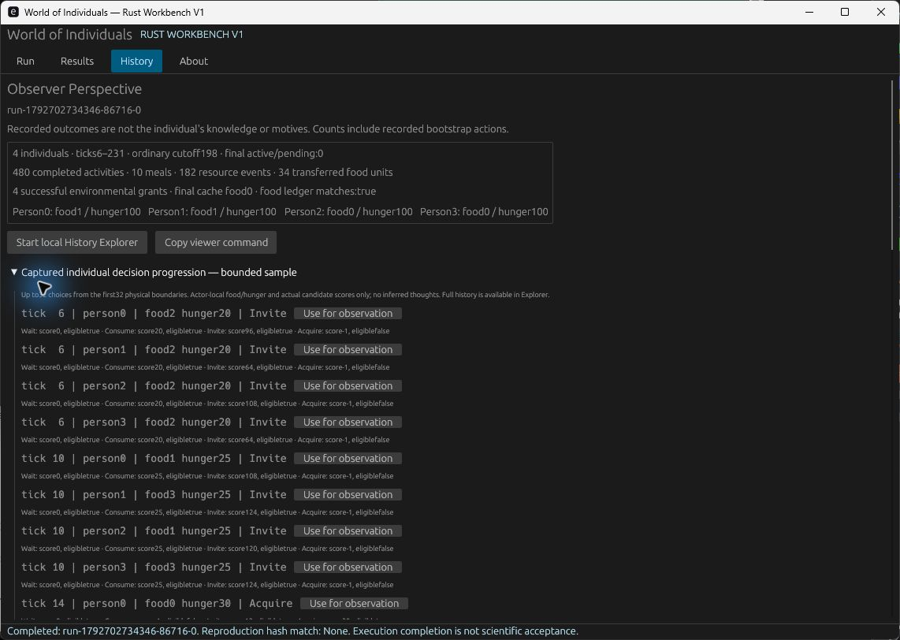

# Rust Workbench V1 acceptance

Engineering milestone completed2026-10-22 on Windows11 Pro10.0.26100, MSVC,
Rust/Cargo1.99.0, Python3.12.6. Starting revision969b52b; implementation published
as `5c22b2dcae32d5e579556188e314902bd5c03d14`. Human guide/navigation published
as `89085d3`. This report records actual execution, not a proposed application.
The first three engineering stages were published together as a functioning
backend/native/history milestone, followed by usability documentation and this
validation milestone. No incomplete intermediate GUI was represented as delivered.

## Start and operate

From the repository:

```powershell
cargo run --release --locked -j 1 --manifest-path tools/workbench/Cargo.toml --features desktop
```

The built `tools/workbench/target/release/woi-workbench.exe` can also be launched
directly while the checkout remains at its build location. Follow the short
[human quickstart](HUMAN_WORKBENCH_QUICKSTART.md). CLI fallback uses the same Rust
backend; `--help` lists run/list/inspect/reproduce/viewer/observe commands.

Supported: authentic023 Continuous World, all12 actual scenario presets, unsigned
64-bit seed,1–1024 ordinary ticks, reporting period1–128. Fixed four people,
Continuous/Epoch/Ascending, claim4, cadence8, capacity2.024/025 are explicitly
unavailable; no fictional controls or new policy. See the
[verified runner table and ownership decision](rust-first-workbench-architecture.md).

## Real execution and reproduction

Stage A invoked the documented Rust runner twice into new paths; both actual
3,416,858-byte histories were identical. Stage B then used the Rust backend to
persist configuration, source identity, argument vector, process result and output
hash, inspect the world and reproduce it into a fresh directory, before UI work.

Native GUI Run produced `run-1792701315150-97944-0`. Native Reproduce subsequently
created `run-1792701702337-96584-0`, `exact_match:true`; the originals remain intact.
The optimized release window separately launched:

| Field | Actual result |
|---|---|
| Run | `run-1792702734346-86716-0` |
| Directory | `target/workbench-runs/run-1792702734346-86716-0/` |
| Source revision | `5c22b2dcae32d5e579556188e314902bd5c03d14` |
| Runner input fingerprint | `3c5d545079147dcf67b1e6f8cace154b039ef3d2fe8f9e6711fcc37976bc1a8b` |
| Settings | paired, seed42, ordinary192, period11 |
| Actual clock | epoch6, nominal cutoff198, drained endpoint231 |
| Completed commitments |480 |
| Consumption records |10 meals |
| Resource action records |182, including bootstrap;34 units of transfer volume |
| Acquisition resolutions |4 successful grants;2 depleted-cache responses |
| Final state |person0 food1/hunger100;1 food1/hunger100;2 food0/hunger100;3 food0/hunger100; cache0; no active/pending final work |
| Food ledger |initial12 = final owned2 + cache0 + consumed10 |

All three native histories share SHA256:
`24e6046ec2af86d6bee7a3c2e3cb6a1b95459522f783f39192167f75e946b5be`.
Source revision and dirty state are stored separately: the release run's dirty
warning referred to pending navigation/docs, while every frozen023 runner input
was verified. Different future documentation HEADs correctly warn on reproduction;
byte equality is independently compared, never assumed from the warning or seed.

Meals/contact/transfers are not a universal utility ranking. In particular, all
four terminal hunger values are100; neither this application nor this example
claims optimal, sustainable, psychologically realistic or globally beneficial behavior.

## Native and detailed inspection actually exercised

Windows Computer Use exercised actual egui controls, keyboard entry and native
rendering, rather than a policy probe or synthetic GUI self-test:

- Minimal native window compiled and opened before elaborating the interface.
- Zero duration visibly reported its bound and disabled Run; restoring192 enabled it.
- Run launched the existing Rust process, disabled duplicate launch while busy and
  displayed its actual Completed metadata. Results selected persisted runs.
- Inspect displayed the above actual final state and bounded captured choices.
  Person0 at tick6 had own food2/hunger20; candidates included Invite96/Consume20,
  with Invite actually selected. Later sampled choices include acquisition and meals.
- Reproduce created the fresh native result above with a matching hash.
- Use for observation populated person0/tick6, actual local food/hunger and Invite.
  A native saved note is
  `observations/note-1792702794850-86716-0.json` under the release run. Its run ID,
  source and history hash are bound to that run; its interpretation stays external.
- Start local History Explorer launched the unchanged Python viewer on127.0.0.1.
  The native app also generates a properly quoted PowerShell fallback command.
  The viewer verified and loaded actual `history.jsonl`, original record0, custom023,
  not an original registered experiment substituted for this demonstration.
- Detailed browser inspection selected individual1/tick16. Observer showed the
  meal record and resource compartments. Actor explicitly reported no owned
  decision input at that meal record, rather than filling it from observer history.



The existing Explorer's catalog contains815 entries in this session. Expand its
history chooser, search023, select custom prototype, then Open selected history.
Selecting an option alone does not load it. Both Actor and Observer perspectives
remain available through the unchanged versioned adapter.

## Acceptance and failure coverage

| User criteria | Evidence / disposition |
|---|---|
|1–5 native app, typed config, real four-person mode, source-free human configuration, actual simulator |Actual debug/release GUI and backend workflow above; no simulation implementation copied into UI |
|6–9 safe new storage, protected-path rejection, source identity, fresh reproduction |New directories only; strict typed JSON; path-separator/traversal/link/reparse rejection; recorded Git revision/fingerprint; actual exact replay |
|10 honest failure |Nonexistent executable, nonzero child and zero-exit/missing-history fault controls remain Incomplete; invalid source/config fail before launch |
|11–14 real summary, detailed access, perspective boundary, actual GUI use |Native outcomes, captured local sample and actual browser inspection above |
|15–19 no policy/026/025 adoption, validation preserved, justified Python boundary |Unchanged scientific source/archives; independent gates below; no new Python code |
|20 practical guide and reproducible acceptance |Quickstart, architecture, this report, image, executable tests and retained task logs |

Reader tests distinguish missing/truncated/corrupt/unfinished/unsupported output,
including a valid unknown envelope with an unfamiliar body. Required fields are
not silently zero-filled. Missing/corrupt run metadata prevents inspection as a
completed run. Histories are hash-checked against saved completion metadata.
The reader admits one023 JSONL trial up to64MiB, skips unused state, caps long
sequences at65536 entries and retains at most32 samples plus the last record.
It deliberately makes a lightweight header-validation pass before typed projection;
this is an observer structural/ledger check, not an independent scientific reader.

Regression coverage includes duplicate/new paths, attempted protected path traversal,
invalid/unknown configuration/scenario/mode, no arbitrary saved executable/arguments,
exact revision, new reproduction directory, changed-revision warning, accurate
known-run counts, note isolation, viewer command generation and missing optional
Python. The real acceptance suite executes all12 presets at64ticks, plus paired
ticks1/period128/seedu64::MAX and ticks1024/period1/seed0. It separately runs a real
default world and exact reproduction. These are engineering executions, not a new
scientific experiment or independent statistical replications.

Preserved development failures: the first real parser assumed every work kind was
a string; actual Resource work is structured, so the old run stayed Incomplete.
That parser was corrected and real execution/reproduction rerun. A Windows linker
attempt against an executing test binary failed; subsequent validation used isolated
targets or closed the owned process. Initial Clippy large-enum and formatting
findings were corrected. All corresponding logs remain; no final check is failing.
Engineering fixture runs were moved intact under `acceptance-tests/`; normal human
run lists do not mix those artificial fault records with the three native runs.

## Validation and scientific preservation

All commands exited0 on the delivered implementation content:

| Check | Result | Log under `target/workbench-interface-audit/` |
|---|---|---|
|Root `cargo fmt --check` |PASS |root-fmt.log |
|Root `cargo clippy --locked --all-targets -j 1 -- -D warnings` |PASS |root-clippy.log |
|Root `cargo test --locked -j 1` |217pass |root-tests.log |
|`cargo run --release --locked -j 1 --example validate_contract` |Complete read-only foundation through024;408 protected artifacts/425 raw originals |foundation.log |
|`cargo run --release --locked -j 1 --example validate025_acceptance` |214 custody bindings; full original025 gate,50 exact replays, completion/corruption/food-fate controls |candidate025.log |
|Workbench `cargo fmt --manifest-path tools/workbench/Cargo.toml --check` |PASS |workbench-fmt-final.log |
|Workbench locked Clippy/all-targets, desktop feature |PASS |workbench-clippy-final2.log |
|Workbench locked Clippy/all-targets, CLI-only |PASS |core-clippy-final.log |
|Workbench locked desktop-feature tests |5pass;2 expensive tests explicitly ignored here |workbench-desktop-final-tests2.log |
|Workbench locked CLI tests `-- --include-ignored`, separate target |7pass, including both real-run acceptance tests;16 real worlds |core-final-acceptance2.log |
|Workbench release build `--locked --features desktop -j 1` |PASS; real optimized window/run inspected |desktop-release-final.log |

The separate acceptance target was selected with
`--target-dir target/workbench-core-acceptance`; it prevents the Windows GUI/test
binary lock from blocking validation. Manifest flag is
`--manifest-path tools/workbench/Cargo.toml`. Desktop tests/Clippy add
`--features desktop`; all checks use `-j 1` and locked dependencies where applicable.

Foundation/source/helper identities stayed unchanged after their complete passes.
A subsequent read-only025 custody recheck again returned214. Git shows no changes
to `src/`, `prototypes/`, `experiments/`, `examples/`, root Cargo files, scientific
contracts or canon. No frozen archive was regenerated in place. The protected
endpoint remains001–024; reviewed025, its failed prefix, corrected observer2,
food-attribution challenge and unadopted candidate remain separate and unchanged.
No new cognition, retention signals, planner, policy, default or026 was introduced.
Old mode-specific persistent-state/forgetting exceptions remain intact.

No new simulator throughput benchmark was needed: simulator code/workload rules
did not change. Workbench-specific build/runtime/storage measurements follow.
Checks are not repeated merely because navigation documentation changes; all final
code content matches the implementation revision tested above.

## Cost and limitations

These wall-clock/process/storage observations are separate from deterministic
histories and are not performance distributions or scientific evidence:

- First egui dependency/debug build2m44s; first optimized desktop build5m19s.
  Switching the existing host invocation to the verified absolute-path backend
  incurred one2m29s host rebuild; later process launches were warm.
- Release GUI's existing Cargo+simulator process took301ms. This stored timer
  excludes source preflight and post-exit history parsing/hashing. A separate warm
  optimized CLI inspect, including process startup/hash/two-pass parse/JSON output,
  took128.56ms in this session.
- Actual paired history3,416,858bytes; the tested1024-tick history17,989,832bytes.
  Run metadata/logs/notes are additional local files. Whole histories are not
  duplicated into metadata. Native sequence samples are bounded; directories and
  human notes grow until the creator manages exploratory storage.
- Optimized executable5,980,160bytes. Combined local debug/release/check build
  artifacts occupied2,637,878,944bytes in the measured target directory; that is
  build-cache cost, not a portable distribution size. A release-window working-set
  snapshot was96,145,408bytes; no memory profiler or bound claim is implied.
- The first optional viewer startup exceeded45s while building020/021 discovery
  indexes. This failure was reported honestly. The corrected bridge shares only
  derived exploratory cache, permits180s, and waits for the child's actual server
  announcement plus loopback connection. Cold startup then passed; warm release
  startup passed as well. Original sources stay read-only. No viewer refactor.

This is source-checkout software, not an installer or standalone simulator bundle.
Rust/Cargo/Git and existing Python host generation are still needed. GPU/desktop
support outside the tested Windows environment is unaccepted. The native reader
supports one schema and bounded samples; full actor/provenance/causal navigation
uses the existing Python/JavaScript Explorer. No cancellation, resume, live simulation
stepping or automatic scientific acceptance. Closing during an active GUI operation
is deferred; a hard interruption can leave honest Incomplete metadata. Ordinary
viewer closure is owned by the workbench; manual fallback commands are user-owned.

## Changed ownership and next use

New Rust modules: config, storage, execution, history, observations, viewer and
desktop, with CLI/library entry points and regression/real-run tests. The new
workspace/lockfile does not alter the root Cargo graph. New architecture/quickstart/
acceptance/image and updated map/index/checkpoint document that boundary. Existing
Python scientific readers, build generator and detailed viewer remain unchanged.

The creator can now run, alter supported setup, compare exact reproductions, inspect
captured decisions/outcomes and save questions without an AI coding session. The
smallest justified next improvement is to make selecting the new custom history
in the existing Explorer easier, if hands-on use confirms that friction. Collect
real creator observations first; no further behavioral experiment is authorized.
